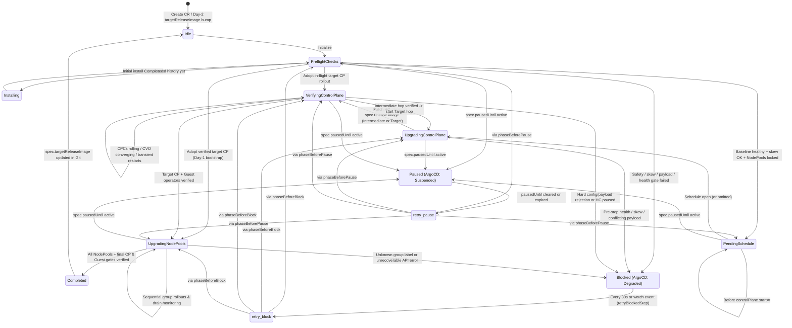
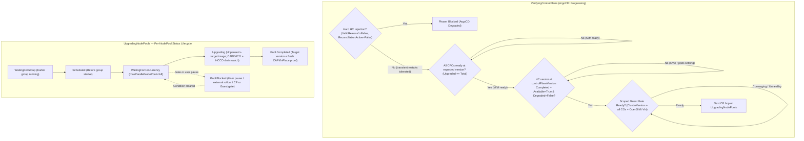

# HyperShift Upgrade Coordinator User Guide

This user guide explains how to install, configure, and operate the **HyperShift Upgrade Coordinator (HUC)** to automate and observe upgrades for OpenShift Hosted Control Planes and worker NodePools.

---

## 1. Overview

The HyperShift Upgrade Coordinator is a Kubernetes operator that automates multi-stage upgrades of OpenShift Hosted Control Planes and worker NodePools.

### Key Capabilities
- **Coaligned Naming:** Binds each `HostedClusterUpgrade` directly to its matching `HostedCluster` by name and namespace.
- **EUS Multi-Hop Upgrades:** Orchestrates 2-minor version hops (e.g. 4.14 → 4.15 → 4.16) in a single declarative resource, holding worker nodes paused until the control plane reaches the target release.
- **Scheduled Rollouts:** Configures independent earliest-start gates (`startAt`) for control plane and worker groups.
- **Group Rollout Sequencing:** Upgrades worker NodePools sequentially by group (`upgrade.huc.0xshift.dev/group`), allowing critical infrastructure pools to verify before general compute nodes upgrade.
- **NodePool Concurrency Bounds:** Limits concurrent NodePool upgrades within an active group (`maxParallelNodePools`).
- **Comprehensive Guest Cluster Observation:** Validates guest `ClusterVersion`, in-tree `ClusterOperators`, and OpenShift Virtualization health at every upgrade step using scoped, short-lived tokens.
- **Automated Drain Diagnostics:** Gathers HCCO logs to surface cluster-level drain and pod eviction blockers during rolling worker updates.

---

## 2. Prerequisites

Before installing the coordinator:
1. An active Kubernetes or OpenShift cluster running the HyperShift operator.
2. CLI access via `oc` or `kubectl` with cluster-admin privileges.
3. The `kustomize` CLI binary (v5 or later).
4. One or more managed `HostedCluster` resources (e.g. in the `clusters` namespace).

---

## 3. Installation & Guest Access Setup

By default, the coordinator runs in the `hypershift-upgrade-coordinator` namespace.

### Step 1: Create the Operator Namespace
```bash
oc create namespace hypershift-upgrade-coordinator
```

### Step 2: Deploy HUC via Kustomize
Deploy all CRDs, RBAC, admission webhooks, Prometheus rules, and the coordinator deployment:
```bash
kustomize build config/default | oc apply -f -
```

### Step 3: Verify the Deployment
Confirm that the coordinator pod is running:
```bash
oc get pods -n hypershift-upgrade-coordinator
```

---

## 4. Configuration Flags & Guest Connectivity

The coordinator supports the following deployment flags:

| Flag | Default | Description |
| :--- | :--- | :--- |
| `--operator-namespace` | Derived from Pod namespace | Namespace where HUC is deployed and stores observer delivery secrets. |
| `--hosted-cluster-namespace` | `clusters` | Filters which namespaces HUC reconciles. Leave empty (`""`) to manage all namespaces across the fleet. |
| `--guest-endpoint-mode` | `internal` | How HUC connects to the guest kube-apiserver: `internal` (uses cluster-internal Service DNS) or `published` (uses external kubeconfig address). |
| `--guest-observer-namespace` | `huc-guest-observer` | Dedicated namespace created inside each hosted guest cluster for observer resources. |

### Network Connectivity Requirements
- **Management Plane:** HUC must have network egress to management cluster APIs and the HCP namespaces (`clusters-<name>`).
- **Guest Cluster Access:**
  - In `internal` mode (default), HUC connects directly to `kube-apiserver.<derived-control-plane-namespace>.svc` on its Service port with private TLS verification. Ensure network policies allow egress from HUC to the control plane namespaces.
  - In `published` mode, ensure the external/published API server endpoint is reachable from the coordinator pod.

### Scoped Observer Credentials
HUC uses least-privilege credentials to inspect the guest cluster:
- **Bootstrap:** Uses the administrative kubeconfig from `HostedCluster.status.kubeconfig` once to establish observer RBAC.
- **Observer Role:** Creates a dedicated ServiceAccount and ClusterRole (`observer-v2`) in the guest cluster with strictly read-only permissions (`get` on ClusterVersion; `list` on ClusterOperators, HyperConverged, and KubeVirt).
- **Short-Lived Tokens:** Issues 1-hour bearer tokens via `TokenRequest` and stores them in a Secret (`guest-observer-<HC_UID>`) inside HUC's deployment namespace.
- **Automatic Renewal:** Automatically rotates tokens before expiration.

---

## 5. Configuring NodePool Groups

Before initiating an upgrade, assign NodePools to logical rollout groups using labels:

```bash
# Infrastructure pools upgrade first:
oc label nodepool infra-pool -n clusters upgrade.huc.0xshift.dev/group=infra

# Compute pools upgrade afterward:
oc label nodepool workers-zone-a -n clusters upgrade.huc.0xshift.dev/group=compute
oc label nodepool workers-zone-b -n clusters upgrade.huc.0xshift.dev/group=compute
```

*Note: Any pool lacking an `upgrade.huc.0xshift.dev/group` label defaults to group `"default"`. Unlabeled pools are automatically upgraded in the final group.*

---

## 6. Triggering an Upgrade

To initiate an upgrade, apply a `HostedClusterUpgrade` manifest matching the target `HostedCluster` name and namespace:

```yaml
apiVersion: upgrade.0xshift.dev/v1alpha1
kind: HostedClusterUpgrade
metadata:
  name: production-cluster-01       # Must match target HostedCluster name exactly
  namespace: clusters               # Must match target HostedCluster namespace
spec:
  # Final target release (digest-pinned)
  targetReleaseImage: quay.io/openshift-release-dev/ocp-release:4.14.0-x86_64@sha256:e2c70fca183e380c6121a1c847806f11e839482123277235a8579db472b9ccf2

  # Optional intermediate release for 2-minor EUS hops
  intermediateReleaseImage: quay.io/openshift-release-dev/ocp-release:4.13.0-x86_64@sha256:74b23ed4bbb593195a721373ed6693687a9b444c97065ce8ac653ba464375711

  # Earliest start for the control plane
  controlPlane:
    startAt: "2026-08-15T02:00:00Z"

  # Maximum concurrent NodePool upgrades within an active group
  rolloutPolicy:
    maxParallelNodePools: 1

  # Ordered sequence of rollout groups
  nodePoolGroups:
    - name: infra
      startAt: "2026-08-15T04:00:00Z"
    - name: compute
      startAt: "2026-08-15T05:00:00Z"
```

Apply the manifest:
```bash
oc apply -f upgrade.yaml
```

To schedule a subsequent upgrade in the future, simply update `targetReleaseImage` (and `intermediateReleaseImage`) in the existing manifest. Deleting and recreating the CR is not required.

---

## 7. State Machine, Status Messages & Recovery Paths

### A. Top-Level `status.phase` State Machine

Every `HostedClusterUpgrade` progresses along the green path (`Idle` $\to$ `Completed`). Two interrupt states (`Paused` and `Blocked`) preserve the exact interrupted step in `status.phaseBeforePause` and `status.phaseBeforeBlock`, resuming that step directly without restarting already-running or completed rollouts:



### B. Sub-Step Verification & Worker Group Pipeline

Inside `VerifyingControlPlane` and `UpgradingNodePools`, HUC evaluates layered management and guest gates before advancing:



### C. Status Message & Green-Path Runbook

| `status.phase` (Argo CD) | Typical `status.message` / Sub-State | What It Means | Expected / Required Action for Green Path |
| :--- | :--- | :--- | :--- |
| `Installing` (`Progressing`) | `HostedCluster is currently in initial installation...` | `HostedCluster.status.version.history` has no `Completed` entry yet. | **No action (wait).** Advances automatically to `PreflightChecks` once initial cluster install finishes. |
| `PreflightChecks` (`Progressing`) | `Preflight CP prerequisite: ...` or `guest SourceBaseline: Converging ...` or `requires ClusterVersionUpgradeable=True` | Cluster is healthy enough to avoid a hard block, but CVO/operators are still settling or `Upgradeable=False` is set. | **Wait** if operators are converging. If `ClusterVersionUpgradeable=False` persists, inspect guest `ClusterVersion` admin-acks / operator upgradeability blockers. |
| `PendingSchedule` (`Progressing`) | `Control Plane upgrade is scheduled to start at <RFC3339> (in ...)` | All preflight gates passed and worker NodePools are locked; waiting for `spec.controlPlane.startAt`. | **No action (wait)** for scheduled window, or clear/advance `spec.controlPlane.startAt` in Git to start immediately. |
| `UpgradingControlPlane` (`Progressing`) | `Previous CP prerequisite: ...` or `guest BeforeControlPlaneRequest: ...` | Schedule is open; re-verifying baseline CP, worker quiescence, and guest health right before patching `HostedCluster.spec.release.image`. | **No action (wait)** if transient; if guest virtualization reports outdated workloads or non-upgradeable HCO on EUS hop, align operator channel/CatalogSource. |
| `VerifyingControlPlane` (`Progressing`) | `Waiting for Control Plane components to complete rollout to <ver> (X/Y ready).` | HyperShift is rolling out control-plane pods (`etcd`, `kube-apiserver`, `openshift-apiserver`, etc.). Transient `UnavailableReplicas` (`Degraded=True`) or brief API restarts are normal here. | **No action (wait).** Inspect `status.controlPlaneStatus.blockers` only if `X/Y` stops advancing for >30–45m. |
| `VerifyingControlPlane` (`Progressing`) | `waiting for latest version Completed history...` or `HostedCluster contains degraded condition...` or `guest IntermediateVerification / WorkerEntry: ...` | All CPCs reached `<ver>`, and guest CVO / in-tree `ClusterOperators` / OpenShift Virtualization are finishing operand convergence. | **No action (wait)** during normal CVO rollout. In EUS upgrades with OpenShift Virtualization, ensure the guest operator CatalogSource/Subscription is updated for the target minor so HCO becomes `Upgradeable` and healthy. |
| `UpgradingNodePools` (`Progressing`) | Pool `Scheduled` / `WaitingForGroup` / `WaitingForConcurrency` / `Upgrading` | Sequential worker rollout active. Pools wait for prior groups, group `startAt`, or `maxParallelNodePools` slots. | **No action (wait).** If a pool stays in `Upgrading` with `status.drainDiagnostics.messages`, inspect guest PDBs or non-migratable VMs blocking eviction. |
| `UpgradingNodePools` (`Progressing`) | Pool `Blocked`: `Paused by user...` / `Externally started or unproven worker rollout...` / `guest WorkerGuard: Unhealthy...` | That specific pool cannot be actuated yet (overall HCU remains `UpgradingNodePools` while other active pools finish). | Clear external `NodePool.spec.pausedUntil` if unintended, wait for external config rollout to quiesce, or resolve the degraded guest `ClusterOperator` / outdated VMI workloads shown in `status.guestAssessment.blockers`. |
| `Paused` (`Suspended`) | `Upgrade coordinator is paused via spec.pausedUntil.` | HUC is in observe-only mode (metrics, CPCs, and group labels still refresh; no downstream spec mutations occur; already-running HyperShift rollouts continue). | Wait for RFC3339 `spec.pausedUntil` expiry, or remove/set `spec.pausedUntil: "false"` in Git to resume `status.phaseBeforePause`. |
| `Blocked` (`Degraded`) | `Release payload safety gate blocked: ...` | Pull-secret, mirror (`ImageDigestMirrorSet`/`ICSP`), CA bundle (`additionalTrustBundle`), digest, or CPU architecture check failed. | Verify mirror sync for target/intermediate digest, `HostedCluster.spec.pullSecret` credentials, and `additionalTrustBundle` CA cert. HUC auto-retries every 30s. |
| `Blocked` (`Degraded`) | `Upgrade plan safety gate blocked: NodePool "..." references unknown group "..."` | A `NodePool` has an `upgrade.huc.0xshift.dev/group` label not listed in `spec.nodePoolGroups`. | Add the group to `spec.nodePoolGroups` or fix the `NodePool` label; HUC auto-recovers immediately via `NodePool` / HCU watch. |
| `Blocked` (`Degraded`) | `NodePool "..." worker <ver> violates same-major n-3 skew...` or `Upgrade version safety gate blocked...` | Planned release path violates monotonic semver, 1-minor hop limit, or HyperShift `n-3` worker skew, or `spec.controlPlaneRelease` override is set. | Fix `targetReleaseImage` / `intermediateReleaseImage` in Git or upgrade lagging NodePools first; remove unsupported `HostedCluster.spec.controlPlaneRelease`. |
| `Blocked` (`Degraded`) | `Preflight Checks Blocked: ...` / `Pre-Step Health Gate Blocked CP Upgrade: ...` | Cluster had `Degraded=True`, `ClusterVersionFailing=True`, or `Available=False` **before** a new upgrade step was initiated. | Fix the pre-existing `HostedCluster` / guest `ClusterOperator` health issue first. Once healthy, HUC automatically resumes `status.phaseBeforeBlock`. |
| `Blocked` (`Degraded`) | `Control Plane Rollout Blocked: HostedCluster ...` (`ValidRelease*=False`, `ClusterVersionReleaseAccepted=False`, `ReconciliationActive=False`) | HyperShift or CVO explicitly rejected the release image/configuration, or `HostedCluster.spec.pausedUntil` paused HyperShift mid-rollout. | Unpause `HostedCluster.spec.pausedUntil` or point `HostedClusterUpgrade` to a valid release image. |
| `Completed` (`Healthy`) | `All upgrade steps successfully verified and completed.` | Control plane, guest `ClusterOperators`, OpenShift Virtualization, and all `NodePool`s are verified on `spec.targetReleaseImage`. | **Green steady state.** Keep CR in Git; bump `spec.targetReleaseImage` (and optional `intermediateReleaseImage`) to start the next upgrade cycle. |

### Safety Features
- **Strict 1-Minor Jumps:** Validating webhooks reject any single step exceeding 1 minor version jump.
- **Worker Skew Protection (n-3):** Control plane upgrades halt if any worker NodePool is more than 3 minor versions behind the target release.
- **Self-Healing Skip:** If a cluster has already reached the intermediate release, HUC skips the redundant intermediate step and proceeds directly to the target release.
- **Lock Preservation:** If an SRE sets `spec.pausedUntil: "true"` on a NodePool manually, HUC preserves the user pause and will not unpause the pool when upgrades finish.
- **OpenShift Virtualization Gates:** If virtualization is detected, HUC ensures that operator versions align with OpenShift minor versions and that all VMs are ready for live migration before worker nodes drain. See [OpenShift Virtualization Assessment](virtualization-assessment.md).

---

## 8. Monitoring & Troubleshooting

### Tracking Upgrade Progress
Check status, node counts, and the `NODE-BLOCKERS` overview column via CLI:
```bash
oc get hostedclusterupgrade production-cluster-01 -n clusters
```
`NODE-BLOCKERS` summarizes whether worker pools or node drains are currently blocked (e.g. `None`, `1 node drain blocked (force in 18m)`, `1/2 pools blocked`, or `Drain eviction failing`).

View detailed component progress, per-pool CAPI `drains`, blockers, and guest assessments:
```bash
oc describe hostedclusterupgrade production-cluster-01 -n clusters
```

### Troubleshooting Blocked Node Drains
If a worker node drain stalls (e.g. due to `PodDisruptionBudget`s or non-migratable VMs):
1. **Quick CLI Overview:** `oc get hostedclusterupgrade <name> -n <ns>` surfaces blocked CAPI drains, blocked pools, or HCCO eviction failures directly in `NODE-BLOCKERS` and `STATUS-MESSAGE`.
2. **`Replace` Pools (`status.nodePoolStatuses[].drains`):** HUC inspects deleting CAPI `Machine` conditions (`DrainingSucceeded`, `PreDrainDeleteHookSucceeded`, `VolumeDetachSucceeded`), `nodeDrainStartTime`, and `NodePool.spec.nodeDrainTimeout` / `nodeVolumeDetachTimeout`, reporting the exact blocking pods/PDBs and `forceDrainAt` countdown per NodePool.
3. **`InPlace` Pools (`status.drainDiagnostics.messages`):** Upstream HyperShift `InPlace` upgrades drain via HCCO rather than CAPI `Machine` deletion (and upstream HCCO does not enforce `NodePool.spec.nodeDrainTimeout`); HUC surfaces active eviction failures from HCCO logs in `status.drainDiagnostics.messages` and `NODE-BLOCKERS`.
4. **OpenShift Virtualization:** Audit running VMs to ensure they have `evictionStrategy: LiveMigrate` and are not bound to local storage. See [Non-Migratable VMs](virtualization-assessment.md#non-migratable-vms-and-nodepool-drain-blockers).
### Observability & Dashboards
- **Grafana Dashboard:** Import [`docs/monitoring/grafana-dashboard.json`](monitoring/grafana-dashboard.json) to monitor fleet upgrades, phase progressions, and drain hints in real time.
- **Prometheus Alerts:** Pre-packaged alert rules notify SREs if an upgrade is blocked, credentials fail to rotate, or a node drain exceeds SLA thresholds. See [Monitoring & Alerting](monitoring.md).
